# Website Architecture — majalis.pk

## File Structure

```
majalis-pk/
├── index.html
├── package.json
├── vite.config.js
├── public/
└── src/
    ├── main.jsx                  # Vite entry point — mounts <App />
    ├── index.css                 # Tailwind v4 + Inter font + Material Symbols
    ├── App.jsx                   # Router — defines all 11 routes
    │
    ├── components/
    │   ├── Navbar.jsx            # Desktop top navigation bar
    │   ├── MobileNav.jsx         # Fixed bottom mobile navigation
    │   └── Footer.jsx            # Site footer with links
    │
    └── pages/
        ├── Home.jsx              # Landing page — hero, day filter, cards
        ├── BrowseMajalis.jsx     # Majlis listing with filters
        ├── MajlisDetail.jsx      # Single majlis — info + comments
        ├── BrowseJaloos.jsx      # Jaloos listing with filters
        ├── SpeakerProfile.jsx    # Speaker bio + upcoming/past sessions
        ├── VerifiedImambargah.jsx# Imambargah detail — amenities + gallery
        ├── ImambargahPortal.jsx  # Portal dashboard for imambargah admins
        ├── ContactUs.jsx         # Contact form + info cards
        ├── Settings.jsx          # User settings tabs
        ├── AdminPanel.jsx        # Super-admin dashboard
        └── ComingSoon.jsx        # Launch notification signup
```

## Route Map

| Route | Page Component | Auth Required | Description |
|---|---|---|---|
| `/` | `Home.jsx` | No | Landing page with featured majalis |
| `/browse-majalis` | `BrowseMajalis.jsx` | No | Search/filter majalis listings |
| `/majlis/:id` | `MajlisDetail.jsx` | No | Single majlis detail view |
| `/browse-jaloos` | `BrowseJaloos.jsx` | No | Search/filter jaloos listings |
| `/speaker-profile` | `SpeakerProfile.jsx` | No | Speaker bio and sessions |
| `/verified-imambargah` | `VerifiedImambargah.jsx` | No | Imambargah detail page |
| `/imambargah-portal` | `ImambargahPortal.jsx` | Yes | Portal for imambargah admins |
| `/contact` | `ContactUs.jsx` | No | Contact form |
| `/settings` | `Settings.jsx` | Yes | User preferences |
| `/admin` | `AdminPanel.jsx` | Yes (Admin) | Super-admin dashboard |
| `/coming-soon` | `ComingSoon.jsx` | No | Launch notification signup |
| `*` | Redirects to `/` | No | Catch-all 404 redirect |

## Component Tree

```mermaid
graph TD
    main["main.jsx"]
    app["App.jsx (Router)"]
    navbar["Navbar.jsx"]
    mobilenav["MobileNav.jsx"]
    footer["Footer.jsx"]
    home["Home.jsx"]
    browse["BrowseMajalis.jsx"]
    detail["MajlisDetail.jsx"]
    jaloos["BrowseJaloos.jsx"]
    speaker["SpeakerProfile.jsx"]
    imam["VerifiedImambargah.jsx"]
    portal["ImambargahPortal.jsx"]
    contact["ContactUs.jsx"]
    settings["Settings.jsx"]
    admin["AdminPanel.jsx"]
    coming["ComingSoon.jsx"]

    main --> app
    app --> navbar
    app --> mobilenav
    app --> footer
    app --> home
    app --> browse
    app --> detail
    app --> jaloos
    app --> speaker
    app --> imam
    app --> portal
    app --> contact
    app --> settings
    app --> admin
    app --> coming

    subgraph shared["Shared Components"]
        navbar
        mobilenav
        footer
    end

    subgraph pages["Page Components"]
        home
        browse
        detail
        jaloos
        speaker
        imam
        portal
        contact
        settings
        admin
        coming
    end
```



## Data Flow

```
                    ┌──────────────────────┐
                    │    No Backend API     │
                    │  (All data is inline) │
                    └──────────────────────┘
                              │
                              ▼
    ┌─────────────────────────────────────────────┐
    │              App.jsx (Router)                │
    │  - react-router-dom v7.18.0                 │
    │  - 11 routes + catch-all redirect            │
    └─────────────────────────────────────────────┘
         │          │              │
         ▼          ▼              ▼
    ┌────────┐ ┌────────┐  ┌──────────────┐
    │ Navbar │ │Mobile  │  │   Footer     │
    │ (desk) │ │Nav     │  │              │
    └────────┘ └────────┘  └──────────────┘
         │
         ▼
    ┌──────────────────────────────────────┐
    │         Page Components              │
    │  - Each page defines own data inline │
    │  - No shared state management        │
    │  - No API layer                      │
    │  - No React Query / SWR              │
    └──────────────────────────────────────┘
```

### Current Limitations
- **No state management**: No Redux, Zustand, or Context API
- **No API layer**: All pages import hardcoded arrays from within the same file
- **No loading states**: No spinners, skeletons, or Suspense boundaries
- **No error handling**: No try/catch, error boundaries, or fallback UIs
- **No persistence**: Settings, comments, and form submissions are lost on refresh

## Technology Stack

| Layer | Technology |
|---|---|
| Build tool | Vite |
| Framework | React 19 |
| Routing | react-router-dom v7.18.0 |
| Styling | Tailwind CSS v4 |
| Font | Inter (Google Fonts) |
| Icons | Material Symbols Rounded |
| State | None (inline component state only) |
| API | None |

## Key Dependencies (from package.json)

```json
{
  "dependencies": {
    "react": "^19.1.0",
    "react-dom": "^19.1.0",
    "react-router-dom": "^7.18.0"
  },
  "devDependencies": {
    "@tailwindcss/vite": "^4.1.4",
    "@vitejs/plugin-react": "^4.4.1",
    "tailwindcss": "^4.1.4",
    "vite": "^6.3.2"
  }
}
```
